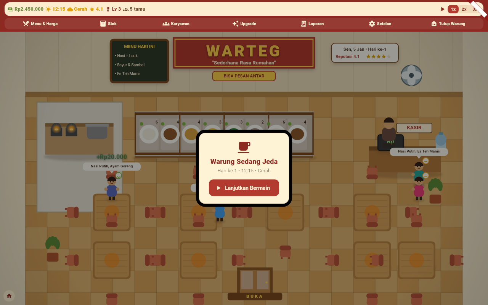
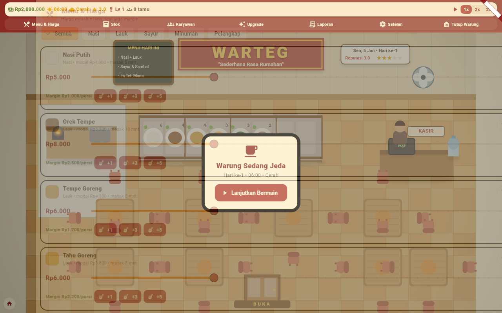

# 🍛 Warteg Simulator

Game simulasi warung tegal khas Indonesia. Kelola modal, belanja bahan, masak,
layani pelanggan, atur harga, rekrut karyawan, upgrade warung, dan kembangkan
usaha dari warung kecil menjadi bisnis dua cabang.

> **⬇️ Unduh cepat (rilis v1.0.0, hasil build CI):**
> - Android: [warteg-simulator-v1.0.0.apk](https://github.com/SanzzAza/warteg-simulator-flutter/releases/download/v1.0.0/warteg-simulator-v1.0.0.apk)
> - Windows: [warteg-simulator-v1.0.0-windows.zip](https://github.com/SanzzAza/warteg-simulator-flutter/releases/download/v1.0.0/warteg-simulator-v1.0.0-windows.zip)
> - Semua rilis: https://github.com/SanzzAza/warteg-simulator-flutter/releases

Dibuat dengan **Flutter (stable) + Dart null-safety**, **Flame** (render 2D),
**Riverpod** (state management), **Hive** (penyimpanan lokal), dan
**flame_audio** (efek suara).

Target platform: **Android** (APK/AAB) dan **Windows desktop**, dengan UI
responsif untuk sentuh maupun mouse/keyboard.




> Gambar di atas dirender langsung dari aplikasi (bukan mockup) melalui
> `test/preview_capture.dart`, jadi mencerminkan tampilan sebenarnya.

---

## 1. Cara Menjalankan

### Prasyarat
- Flutter stable (project diuji pada Flutter 3.50.x / Dart 3.14).
- Android: Android Studio + SDK 34+ dan emulator/HP.
- Windows: Visual Studio 2022 dengan workload "Desktop development with C++".

### Langkah
```bash
cd warteg-simulator
flutter pub get
flutter devices          # pastikan emulator/HP/jendela desktop terdeteksi
flutter run              # jalankan di device yang dipilih
flutter run -d windows   # khusus Windows
flutter run -d emulator-5554  # khusus Android
```

### Build rilis
```bash
# APK (langsung instal)
flutter build apk --release
# lokasi: build/app/outputs/flutter-apk/app-release.apk

# Android App Bundle (untuk Play Store)
flutter build appbundle --release
# lokasi: build/app/outputs/bundle/release/app-release.aab

# Windows
flutter build windows --release
# lokasi: build/windows/x64/runner/Release/
```

**Catatan validasi**: proyek ini diverifikasi di lingkungan Linux dengan
`flutter analyze` (bersih), `flutter test` (35 test lolos, termasuk smoke test
layar game + Flame), dan render PNG nyata dari widget/Flame. Build APK/AAB
maupun Windows perlu dijalankan di mesin dengan Android SDK / Visual Studio
sesuai perintah di atas (sandbox pembuat proyek tidak menyediakan keduanya).
Catatan Android: untuk AAB ke Play Store, buat keystore dan isi
`android/key.properties` sesuai dokumentasi resmi Flutter. Build debug/release
default sudah memakai debug key sehingga APK bisa langsung dipasang.

### Menjalankan test
```bash
flutter analyze     # harus "No issues found!"
flutter test        # 35 unit/widget test
flutter test test/preview_capture.dart  # (opsional) render PNG ke design/
```

---

## 1b. Build Otomatis lewat GitHub Actions (APK / AAB / Windows)

Repo ini sudah dilengkapi workflow `.github/workflows/build.yml`. Setiap push ke
branch `main` (atau lewat tab **Actions → Build Warteg Simulator → Run workflow**)
GitHub akan otomatis:

1. `flutter analyze` + `flutter test` (harus lulus),
2. build **APK** (`app-release.apk`),
3. build **AAB** (`app-release.aab`, untuk Play Store),
4. build **Windows** dalam bentuk `warteg-windows.zip`.

Hasilnya bisa diunduh di **tab Actions → pilih run terbaru → panel Artifacts**:

| Artifact | Isi |
| --- | --- |
| `warteg-apk` | APK release siap instal ke HP Android |
| `warteg-aab` | App Bundle untuk Play Store |
| `warteg-windows` | ZIP berisi `warteg_simulator.exe` + DLL pendukung |

Catatan: APK dari CI ditandatangani *debug key* (Flutter default), jadi bisa
langsung diinstal untuk tes. Untuk rilis Play Store, tambahkan keystore sendiri
lewat GitHub Secrets (`KEYSTORE_BASE64`, `KEY_PROPERTIES`) lalu ubah langkah
build sesuai dokumentasi Flutter.

## 2. Cara Bermain (Bahasa Indonesia)

1. **Game Baru** memberi modal **Rp2.000.000** dan stok bahan awal.
2. Buka panel **Menu & Harga**: geser slider untuk mengubah harga jual
   (batas 40%–250% harga dasar). Harga murah membuat pelanggan lebih tertarik,
   harga mahal menurunkan permintaan dan kepuasan.
3. Tekan tombol **+1/+3/+5** pada menu untuk memasak. Masakan membutuhkan
   bahan + waktu masak, lalu muncul di **etalase**.
4. Pelanggan datang, **antre**, **memesan** (memilih lauk sesuai budget &
   selera), **membayar**, **makan**, lalu **pergi**. Indikator emosi 😊😐😠
   di atas kepala menunjukkan kepuasan. Pelanggan bisa **kabur** jika terlalu
   lama menunggu.
5. Panel **Stok** untuk belanja bahan dan memantau kesegaran. Masakan bisa
   **basi** jika tidak laku — kulkas & etalase memperlambatnya.
6. Panel **Karyawan** untuk merekrut juru masak (mempercepat masak), kasir
   (mempercepat transaksi), dan pelayan (mempercepat penyajian & menaikkan
   kepuasan). Karyawan naik skill otomatis dari XP kerja.
7. Panel **Upgrade** untuk etalase, kompor, kulkas, meja & kursi, dekorasi,
   AC/kipas, dan **cabang kedua** (butuh level 5, Rp5.000.000).
8. Panel **Laporan** menampilkan pendapatan, pengeluaran, laba bersih hari ini
   dan riwayat harian. Biaya sewa + listrik + gaji dibayar saat tutup warung.
9. Warung buka **06.00–22.00**; **jam makan siang (11.00–13.00)** paling ramai.
   Cuaca **cerah/mendung/hujan** mengubah jumlah pelanggan; saat hujan
   **minuman panas** (teh hangat, kopi tubruk) lebih diminati.
10. **Reputasi bintang** naik dari kepuasan pelanggan, dan **XP/level** membuka
    menu baru (rendang di level 4, dll.) serta upgrade tertentu.

Game **autosave** setiap 30 detik, saat aplikasi ke background, saat tutup
warung, dan saat kembali ke menu. Tombol **Lanjutkan** di menu utama memuat
save terakhir.

### Kontrol
- **Android**: sentuh tombol HUD dan panel; semua target sentuh ≥ 40 px.
- **Windows/desktop**: mouse sama seperti sentuh; panel manajemen muncul di
  sisi kanan layar. Tombol `Esc`/gesture back menutup panel.

---

## 3. Struktur Proyek

```
lib/
├─ main.dart                     # entry point: Hive + audio + ProviderScope
├─ core/
│  ├─ app_config.dart            # semua angka balancing (modal, sewa, decay, XP)
│  ├─ audio_service.dart         # pembungkus efek suara flame_audio (safe-fail)
│  └─ format.dart                # format Rupiah, jam, bintang
├─ data/
│  ├─ models/
│  │  ├─ ingredient.dart         # 20 bahan + harga + masa simpan
│  │  ├─ menu_item.dart          # 20 menu + resep + harga dasar + level buka
│  │  ├─ customer_type.dart      # 7 tipe NPC: budget, sabar, selera, bobot
│  │  ├─ employee.dart           # peran, gaji, skill
│  │  ├─ upgrade.dart            # 7 upgrade + ekspansi cabang
│  │  └─ game_state.dart         # state pusat + serialisasi JSON (save/load)
│  └─ repositories/
│     └─ save_repository.dart    # Hive: simpan/muat/hapus save (JSON string)
├─ features/
│  ├─ ekonomi/economy_service.dart   # belanja, memasak, kesegaran, biaya
│  ├─ karyawan/staff_service.dart    # rekrut & pecat karyawan
│  ├─ progres/progress_service.dart  # XP, level, reputasi
│  └─ game_controller.dart           # orkestrasi sim: waktu, cuaca, NPC, transaksi
├─ game/                          # LAPISAN FLAME (visual, digambar lewat kode)
│  ├─ warteg_game.dart            # FlameGame + kamera "contain" + sinkron NPC
│  ├─ scene_layout.dart           # tata letak meja, antrean, dapur, kasir
│  ├─ palette.dart                # warna hangat + tint waktu hari
│  ├─ paint_utils.dart            # helper Canvas (teks, panel, bayangan)
│  ├─ customer_pool.dart          # object pool komponen NPC
│  └─ components/
│     ├─ warung_components.dart   # dinding, spanduk, etalase, kasir, dapur
│     ├─ table_component.dart     # meja & kursi plastik
│     ├─ customer_component.dart  # sprite NPC + emosi + balon pesanan
│     └─ floating_text.dart       # teks melayang (+Rp) di-pool
├─ ui/
│  ├─ theme.dart                  # tema Material 3 hangat
│  ├─ widgets.dart                # widget kecil (StatTile, StarRating, dll.)
│  ├─ game/hud.dart               # HUD: uang, waktu, cuaca, reputasi, level
│  └─ screens/
│     ├─ main_menu_screen.dart    # Lanjutkan / Game Baru / Pengaturan / Keluar
│     ├─ game_screen.dart         # GameWidget + HUD + panel + dialog laporan
│     ├─ menu_panel.dart          # menu & harga
│     ├─ stock_panel.dart         # stok bahan, etalase, antrean masak
│     ├─ staff_panel.dart         # karyawan
│     ├─ upgrade_panel.dart       # upgrade & ekspansi
│     ├─ report_panel.dart        # laporan keuangan
│     └─ settings_sheet.dart      # pengaturan
├─ assets/                        # placeholder gambar & suara (lihat assets/README.md)
└─ test/                          # 31 test: ekonomi, kesegaran, save/load, UI
```

Prinsip arsitektur: **logika game murni Dart** (tanpa Flutter) di `features/`
dan `data/`, sehingga bisa diuji unit test; **lapisan Flame** hanya membaca
state dan menggambar; **UI** memakai Riverpod untuk memantau perubahan.

---

## 4. Fitur yang Diimplementasikan

| Kebutuhan | Implementasi |
| --- | --- |
| Ekonomi | Modal Rp2.000.000, format `Rp1.250.000`, pemasukan penjualan, pengeluaran belanja/gaji/sewa/listrik/upgrade, laporan harian laba bersih |
| Menu | **20 menu** (nasi putih, orek tempe, tempe/tahu goreng, telur balado, ayam goreng, sayur lodeh, kangkung, sambal, es teh, teh hangat, kopi, sayur asem, lele, rendang, bakwan, lalapan, kerupuk, es jeruk, mie goreng) dengan harga yang bisa diubah dan memengaruhi permintaan (elastisitas harga) |
| Masak & kesegaran | Resep bahan, waktu masak per porsi, etalase berkapasitas, kesegaran 0–100 yang menurun tiap jam, porsi basi terbuang, kualitas memengaruhi kepuasan & reputasi |
| Pelanggan NPC | 7 tipe (anak kos, pekerja, ojol, ibu RT, mahasiswa, bapak-bapak, anak sekolah) dengan budget, kesabaran, selera kategori, kecepatan; alur datang→antre→pesan→bayar→makan→pergi; indikator emosi; kabur jika kelamaan |
| Karyawan | Rekrut/pecat juru masak, kasir, pelayan; gaji harian; skill 1–5 naik dari XP; skill memengaruhi kecepatan masak, transaksi, penyajian |
| Upgrade | Etalase, kompor, kulkas, meja & kursi, dekorasi, AC/kipas; ekspansi cabang kedua (level 5) menambah kursi, pelanggan, slot karyawan, dan sewa |
| Waktu & cuaca | Siklus pagi–siang–sore–malam dengan jam buka/tutup, lunch rush 11–13, jam malam 18–20; cuaca cerah/mendung/hujan memengaruhi jumlah pelanggan dan preferensi minuman panas |
| Level & reputasi | Reputasi bintang (1–5) dari kepuasan, kesegaran, kecepatan, harga; XP dari penjualan; level membuka menu & upgrade |
| UI | Menu utama, HUD lengkap, 6 panel manajemen, dialog laporan harian — semua Bahasa Indonesia |
| Save otomatis | Autosave 30 detik + saat tutup warung + saat app ke background + saat kembali ke menu; "Lanjutkan" memuat save |

### Performa
- **Object pooling** untuk komponen NPC (`CustomerPool`) dan teks melayang
  (`FloatingTextPool`) — komponen tidak dibuat/dihancurkan tiap pelanggan.
- Sinkronisasi NPC hanya saat daftar pelanggan berubah; data pelanggan dimutasi
  di tempat sehingga komponen membaca objek yang sama (tanpa rebuild berlebih).
- HUD di-refresh maksimum 4×/detik (bukan tiap frame).
- Kamera "contain" berzoom otomatis sehingga dunia 1280×800 selalu utuh dan
  tajam di HP maupun desktop.
- Semua grafis digambar lewat `Canvas` (tanpa decode gambar) → ringan.

### Lifecycle
`WidgetsBindingObserver` di `game_screen.dart` mem-pause simulasi dan menyimpan
save saat aplikasi `inactive/paused/detached`, serta tetap dalam keadaan pause
saat `resumed` agar waktu tidak melompat setelah kembali dari background.

---

## 5. Mengapa Hive (bukan Isar)?

**Hive** dipilih karena:
1. **Tanpa code generation** — proyek tetap ringan dan mudah di-build di
   Android & Windows tanpa langkah `build_runner`.
2. **State disimpan sebagai JSON** (`GameState.toMap()`), sehingga model tetap
   polos, mudah diuji unit test, dan mudah dimigrasi di versi berikutnya.
3. **Stabil & kecil** untuk kebutuhan satu-slot save + autosave; Isar unggul
   untuk query relasional yang tidak dibutuhkan game ini.
4. **Dukungan desktop Windows dan Android** sudah matang dengan satu API
   (`hive_flutter` → `getApplicationDocumentsDirectory`).

---

## 6. Asumsi yang Diambil

1. **Kecepatan waktu**: 1 detik nyata = 3 menit game (1×), dengan opsi 2× dan
   3×. Satu hari (06.00–22.00) ≈ 5 menit 20 detik pada 1×.
2. **Pemain tidak bekerja secara manual per pelanggan**: kasir otomatis
   melayani antrean. Peran pemain adalah menyiapkan stok, masak, mengatur
   harga, dan mengelola sumber daya. Juru masak yang direkrut akan otomatis
   mengisi etalase saat stok menipis.
3. **Masakan dijual dari etalase**: pelanggan hanya bisa memesan menu yang
   sudah dimasak (stok > 0) dan sudah terbuka levelnya. Jika tidak ada menu
   yang cocok/terjangkau, pelanggan pulang (dihitung "kabur").
4. **Biaya tetap** sewa Rp50.000 + listrik Rp15.000 per hari (AC menambah
   Rp8.000/level, cabang menambah Rp30.000) dibayar **saat tutup warung**,
   bersama gaji karyawan (dasar Rp25.000–Rp40.000 + Rp5.000/skill).
5. **Reputasi** bergerak halus menuju rata-rata kepuasan pelanggan; pelanggan
   kabur menurunkan reputasi. Rating dibatasi 1.0–5.0.
6. **Upgrade dekorasi/AC** menaikkan kenyamanan (kepuasan), **kulkas/etalase**
   memperlambat kesegaran, **kompor & juru masak** mempercepat masak,
   **kasir** mempercepat transaksi, **pelayan** mempercepat makan dan
   menaikkan kepuasan.
7. **Cabang kedua** hanya satu tingkat (tidak ada cabang ketiga) dan
   direpresentasikan sebagai penambahan kapasitas & sewa, bukan peta terpisah.
8. **Aset grafis & suara adalah placeholder buatan kode** (bentuk, warna,
   sprite Canvas) dan 5 efek suara WAV sintetis yang dibuat untuk proyek ini.
   Folder `assets/sprites/` dan `assets/audio/` siap diisi aset asli.
9. **Font dibundel** (Roboto & MaterialIcons) di `assets/fonts/` supaya render
   teks identik di Android, Windows, dan saat test.
10. **Tidak ada monetisasi, login, atau backend** — semua lokal dan offline.
11. **Nama hari/tanggal** di kalender hanya dekoratif (mulai Senin, 5 Jan),
    tidak memengaruhi mekanik.
12. **Save satu slot**: Game Baru menimpa save lama setelah konfirmasi.

---

## 7. Balancing Cepat (`lib/core/app_config.dart`)

| Konstanta | Nilai | Arti |
| --- | --- | --- |
| `kModalAwal` | 2.000.000 | modal awal |
| `kMenitPerDetik` | 3.0 | kecepatan waktu dasar |
| `kSewaPerHari` / `kListrikPerHari` | 50.000 / 15.000 | biaya tetap |
| `kFaktorRamaiSiang` | 2.2 | lonjakan pelanggan saat lunch rush |
| `kDecayKesegaranPerJam` | 20 | kesegaran 100 → 0 dalam ±5 jam |
| `kBonusKulkas` / `kBonusEtalase` | 8% / 10% | pengurangan decay per level |
| `xpUntukNaikLevel(l)` | 60·l² | kurva XP |
| `kIntervalAutosaveDetik` | 30 | interval autosave |

Semua data menu, bahan, pelanggan, dan upgrade ada di `lib/data/models/*.dart`
sehingga menambah menu baru cukup menambah satu entri di `kMenu`.

---

## 8. Lisensi Aset

- Font Roboto & MaterialIcons: Apache 2.0 (dari paket Flutter SDK).
- Efek suara WAV: dibuat khusus untuk proyek ini (bebas dipakai).
- Seluruh gambar digambar lewat kode (tidak ada aset pihak ketiga).
